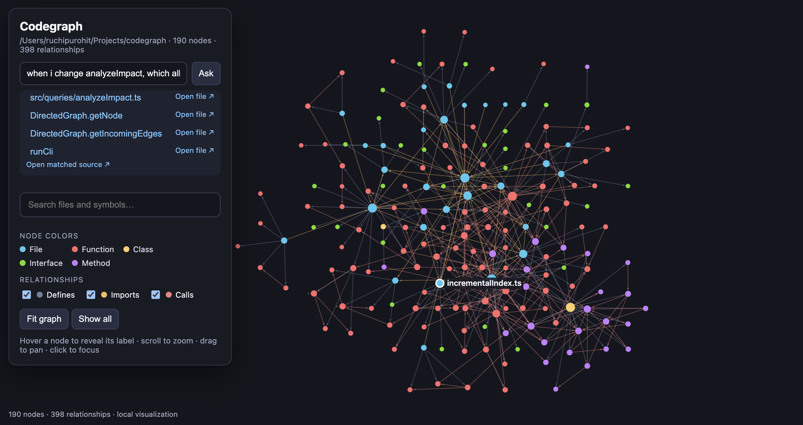

# Codeskope

Codeskope statically analyzes TypeScript repositories and exposes source-code
relationships as a directed graph. The current in-memory engine discovers source
files, parses declarations, resolves internal modules and compiler-resolvable calls,
answers graph queries, calculates reverse impact, and maps tracked Git changes to
the smallest enclosing current symbol.



## Current capabilities

- File, function, class, interface, and method nodes with source ranges.
- `DEFINES`, `IMPORTS`, and `CALLS` edges with provenance and confidence.
- Relative imports, configured TypeScript path aliases, and barrel re-exports.
- Default, named, namespace, aliased, and side-effect import syntax.
- Direct, imported, `this`, concrete-object, injected-object, and interface calls
  when TypeScript can resolve an indexed declaration.
- Symbol search, dependencies, dependents, shortest paths, reverse impact, and
  Git-diff impact analysis.
- A local stdio MCP server with bounded, source-linked tools for coding agents.
- A local, interactive force-directed visualization with search, filters, and
  focused dependency neighborhoods.

## CLI

Install the package in the TypeScript project you want to analyze:

```bash
npm install --save-dev codeskope   # npm
pnpm add -D codeskope              # pnpm
```

Then run the `codeskope` command from the project root:

| Use | npm | pnpm |
| --- | --- | --- |
| Build the graph and save it to `.codeskope/index.json` | `npx codeskope index .` | `pnpm codeskope index .` |
| Update the saved index after source files change | `npx codeskope update .` | `pnpm codeskope update .` |
| Search for symbols by name | `npx codeskope find AuthService --root .` | `pnpm codeskope find AuthService --root .` |
| List what a symbol or file depends on | `npx codeskope deps AuthService.login --root .` | `pnpm codeskope deps AuthService.login --root .` |
| List what depends on a symbol or file | `npx codeskope dependents AuthService.login --root .` | `pnpm codeskope dependents AuthService.login --root .` |
| Find the shortest connection between two symbols | `npx codeskope path AuthController.login TokenService.generate --root .` | `pnpm codeskope path AuthController.login TokenService.generate --root .` |
| Show what could be affected by changing a symbol | `npx codeskope impact AuthService.validateToken --root .` | `pnpm codeskope impact AuthService.validateToken --root .` |
| Show what could be affected by your uncommitted changes (`git diff HEAD`) | `npx codeskope diff --root .` | `pnpm codeskope diff --root .` |
| Open the interactive graph in your browser | `npx codeskope visualize .` | `pnpm codeskope visualize .` |
| Show usage | `npx codeskope --help` | `pnpm codeskope --help` |

With pnpm v10, don't put `--` before the arguments (`pnpm run codeskope -- index .`).
pnpm passes the `--` to the command as a literal argument, and the command then
does nothing.

`index` writes a versioned JSON snapshot to `.codeskope/index.json`. Query
commands rebuild from source by default; pass `--graph` to explicitly reuse the
snapshot when startup speed matters:

```bash
# npm
npx codeskope index .
npx codeskope find AuthService --graph .codeskope/index.json
npx codeskope impact AuthService.login --graph .codeskope/index.json

# pnpm
pnpm codeskope index .
pnpm codeskope find AuthService --graph .codeskope/index.json
pnpm codeskope impact AuthService.login --graph .codeskope/index.json
```

After indexing, open the interactive network in the default browser:

```bash
# npm
npx codeskope visualize .

# pnpm
pnpm codeskope visualize .
```

The viewer reads `.codeskope/index.json`, binds only to `127.0.0.1`, and contains
no CDN scripts or hosted services, so the graph stays on the user's machine.
Use `--graph <file>` for a custom index, `--port <number>` for a fixed port, or
`--no-open` to print the URL without launching a browser. Scroll to zoom, drag
to pan, search by file or symbol, filter relationship types, and click a node to
focus on its immediate incoming and outgoing neighborhood.
Hovering over a node reveals its file or symbol name without permanently
cluttering the graph with labels.

To create a self-contained file that can be opened in an IDE HTML preview,
export the same visualization instead of starting the local server:

```bash
# npm
npx codeskope visualize . --output .codeskope/visualization.html

# pnpm
pnpm codeskope visualize . --output .codeskope/visualization.html
```

All graph data, styles, and interaction code are embedded in the generated HTML;
it does not fetch the index or load scripts from the network.

The **Ask Codeskope** box supports local graph questions such as “What calls
`analyzeProject`?”, “What does `runCli` call?”, “What imports `server.ts`?”, and
“Where is `ProjectSession` defined?”. It matches the question to indexed files
and symbols, selects the relevant relationship and direction, focuses the graph,
and lists connected nodes. This is deterministic graph querying rather than an
LLM, so it does not send repository data to an external service.
Source paths in node details and question results are IDE deep links; clicking
one opens the indexed file at its source line in VS Code-compatible editors.
Change-impact questions use incoming `CALLS` relationships, so they show callers
that may be affected rather than functions the changed symbol itself depends on.

After source files change, update the saved index incrementally:

```bash
# npm
npx codeskope update .

# pnpm
pnpm codeskope update .
```

`update` hashes current source files, detects additions, edits, and deletions,
expands the affected set through reverse imports, replaces stale nodes and edges,
and reuses unaffected graph data. Use `--graph <file>` when the index is stored
somewhere other than `.codeskope/index.json`.

Use `--output <file>` to choose another index location. A cached graph can become
stale after source edits, so rerun `index` before relying on cached results. JSON
is used because the current workflow writes and loads the whole graph and benefits
from a portable, inspectable format. SQLite should be reconsidered when incremental
indexing requires partial updates, database indexes, transactions, or concurrent
readers.

`deps` and `dependents` follow `CALLS` for symbols and `IMPORTS` for file paths.
`path` uses BFS and therefore returns a minimum-edge path across `CALLS` and
`IMPORTS`. `impact` performs reverse BFS with cycle protection.

## MCP for coding agents

The npm package includes a second executable, `codeskope-mcp`. It is a local
stdio process, not a hosted service: the coding agent starts it inside the
consumer repository and communicates with it using MCP messages.

Install the package in the TypeScript project that should be analyzed:

```bash
npm install --save-dev codeskope
# or: pnpm add -D codeskope
```

The MCP client launches the project-local executable with:

```bash
npx --no-install codeskope-mcp --root .
```

`--root` identifies the repository Codeskope should index and defaults to the
process working directory. Use `--index <file>` to override the default
`.codeskope/index.json` location.

### Codex

Run from the consumer project root:

```bash
codex mcp add codeskope -- npx --no-install codeskope-mcp --root .
codex mcp list
```

### Claude Code

Run from the consumer project root:

```bash
claude mcp add codeskope --scope project -- npx --no-install codeskope-mcp --root .
claude mcp list
```

Claude Code stores the shared project configuration in `.mcp.json`.

### Cursor

Create `.cursor/mcp.json` in the consumer project:

```json
{
  "mcpServers": {
    "codeskope": {
      "command": "npx",
      "args": ["--no-install", "codeskope-mcp", "--root", "."]
    }
  }
}
```

Restart Cursor after adding the configuration.

### Other MCP clients

Any MCP client that supports local stdio servers can use the same executable.
The configuration filename and location depend on the client, but the common
configuration shape is:

```json
{
  "mcpServers": {
    "codeskope": {
      "command": "npx",
      "args": ["--no-install", "codeskope-mcp", "--root", "."]
    }
  }
}
```

The server exposes a deliberately small surface:

| Tool | Purpose |
| --- | --- |
| `find_symbol` | Resolve a name to stable node IDs and source ranges. |
| `get_dependencies` | Follow immediate outgoing `CALLS` or `IMPORTS`. |
| `get_dependents` | Follow immediate incoming `CALLS` or `IMPORTS`. |
| `find_path` | Find a bounded minimum-edge path between two nodes. |
| `analyze_impact` | Calculate bounded direct and transitive reverse impact. |
| `analyze_diff` | Map the tracked Git diff to symbols and blast radius. |
| `refresh_index` | Refresh the in-memory graph and persisted JSON index. |

All query tools are read-only. Results include repository-relative source paths
and ranges so an agent can read only the relevant code with its normal file
tools. Limits and depth bounds prevent dumping the complete graph into model
context. The server builds a fresh in-memory graph on the first query; agents
should call `refresh_index` after editing source files.

To make tool selection more reliable, add equivalent instructions to
`AGENTS.md`, `CLAUDE.md`, or the MCP client's project rules:

```md
Use the CodeGraph MCP tools when investigating this TypeScript codebase.

Before modifying an existing symbol:

1. Use `find_symbol` to locate it.
2. Use `get_dependencies` to understand what it uses.
3. Use `get_dependents` or `analyze_impact` to identify what could break.
4. After editing source files, call `refresh_index`.
5. Use `analyze_diff` to review the impact of the changes.

Prefer concise CodeGraph results over reading unrelated files.
```

Applications embedding Codeskope can also construct the server themselves and
connect any MCP transport:

```ts
import { createCodeGraphMcpServer } from "codeskope/mcp";

const server = createCodeGraphMcpServer({ rootDirectory: process.cwd() });
```

## Static-analysis limits

- Dynamic element calls such as `handlers[type]()` may remain unresolved.
- Calls inside arrow functions and anonymous function expressions are not assigned
  to a caller node yet because those declarations are not modeled.
- Interface dispatch points to the compile-time interface method with `inferred`
  confidence; it does not guess a runtime implementation.
- Package and standard-library targets are intentionally outside the project graph.
- Multiple calls between the same two symbols currently produce one `CALLS` edge.
- Overloads and declaration merging can collide under the current syntax-derived
  symbol IDs and need semantic identity work.
- `codeskope diff` analyzes tracked changes relative to `HEAD`. Untracked files and
  deleted symbols are not recoverable from the current AST, and changed lines outside
  modeled declarations are reported as unmapped.
- Query commands rebuild from source unless `--graph` explicitly selects a persisted
  JSON index. `update` performs incremental graph replacement, but it still creates a
  fresh project-wide TypeScript Program so semantic resolution remains correct.

## Releasing

The first npm release was published manually. Subsequent versions publish
automatically when a GitHub Release is published. Before creating the release:

1. Update `version` in `package.json` and `package-lock.json`.
2. Merge that version change to `main`.
3. Create and publish a GitHub Release whose tag is exactly `v<version>` (for
   example, package version `0.2.0` requires tag `v0.2.0`).

The release workflow verifies the tag, installs from the lockfile, runs the type
check, tests, and build, then publishes the public package to npm. The npm package
must have `.github/workflows/publish.yml` configured as a GitHub Actions trusted
publisher for repository `RuchiPurohit/codeskope` with direct `npm publish`
allowed. No long-lived npm token is required.

## The graph model

A **node** (or vertex) represents an entity. An **edge** represents a relationship
between two nodes. In a directed graph, the arrow has meaning:

```text
AuthController.login --CALLS--> AuthService.login --CALLS--> TokenService.generate
```

The first method calls—and therefore depends on—the second. If `A -> B` means A
depends on B, `dependencies(A)` follows outgoing arrows and `dependents(B)` follows
incoming arrows backward. These queries answer different questions:

```text
dependencies(AuthController.login) = [AuthService.login]
dependents(AuthService.login)       = [AuthController.login]
```

An **outgoing edge** starts at the node being examined; an **incoming edge** ends
there. An **adjacency list** stores each node beside its outgoing relationships. A
**reverse adjacency list** stores incoming relationships too. A **traversal** visits
reachable nodes by following edges. A **cycle** is a path that returns to an already
visited node, such as `A -> B -> C -> A`. Nodes are **disconnected** when no path in
the chosen direction connects them; a traversal from one component cannot visit
another.

A directed graph fits Codeskope because relationships such as `CALLS`, `IMPORTS`,
and `EXTENDS` are directional. Who a function calls and who calls that function are
both important, but they are not interchangeable.

## Representation choice

Let `V` be the number of nodes and `E` the number of edges.

| Representation | Storage | Add edge | Get outgoing neighbors | Good fit? |
| --- | ---: | ---: | ---: | --- |
| Adjacency matrix | `O(V²)` | `O(1)` | `O(V)` | Fast edge checks, but wasteful for sparse graphs |
| Adjacency list | `O(V + E)` | expected `O(1)` | `O(out-degree)` | Best fit for Codeskope |
| Edge list | `O(E)` | `O(1)` | `O(E)` | Simple storage, slow relationship queries |

Source-code graphs are generally sparse: each symbol relates to a small fraction
of all symbols. An adjacency list stores relationships that actually exist. This
implementation stores both outgoing and reverse adjacency, using more memory—each
edge is indexed twice—to make both dependencies and dependents efficient.

The nested shape is:

```text
Map<node id, Map<neighbor id, Map<edge type, edge>>>
```

The final map makes `(from, to, type)` the edge identity. Thus duplicate `CALLS`
edges are rejected, while `A --CALLS--> B` and `A --IMPORTS--> B` can coexist.
`Map` also preserves insertion order, producing deterministic traversal results.

Approximate operation costs are:

| Operation | Time | Extra space |
| --- | ---: | ---: |
| Add node | expected `O(1)` | `O(1)` |
| Add edge | expected `O(1)` | `O(1)` (indexed twice) |
| Get dependencies | `O(out-neighbors)` | output size |
| Get dependents | `O(in-neighbors)` | output size |
| BFS / DFS | `O(V + E)` reachable | `O(V)` reachable |
| Find path with BFS | `O(V + E)` reachable | `O(V)` reachable |

An adjacency matrix would be worth reconsidering only for a small, very dense graph
where constant-time arbitrary edge checks dominate. An edge list may be useful as a
serialization format later, but is not a good query index.

## Types and TypeScript concepts

`GraphNode<NodeData>` separates stable identity (`id`) from domain data. Later,
`NodeData` can describe a file or symbol without teaching the graph engine those
concepts. `GraphEdge<EdgeType, EdgeData>` stores direction, relationship type, and
optional metadata. Later, edge data might hold source location or resolution status.

`DirectedGraph<NodeData, EdgeType, EdgeData>` introduces only three useful generics:

- `NodeData`: the application-specific node payload; defaults to `unknown`.
- `EdgeType extends string`: restricts relationships to string names while allowing
  a union such as `"CALLS" | "IMPORTS"`.
- `EdgeData`: optional relationship metadata; defaults to `unknown`.

`unknown` is safer than `any`: consumers must narrow it before using it. `readonly`
prevents mutation through these public types, although it is shallow and does not
deep-freeze nested objects. `Map<K, V>` associates unique keys with values; `Set<T>`
stores unique values and is used by traversals to remember visited node IDs.

## Behavioral decisions

- Duplicate node IDs throw. Silent overwrite could hide a symbol-ID bug.
- Edges require both endpoints to exist. This keeps every adjacency entry valid.
- Duplicate `(from, to, type)` edges throw. Different edge types may coexist.
- Neighbor and dependency queries return unique destination nodes, even if several
  edge types connect the same pair.
- `getNode` returns `undefined` when absent, matching normal `Map.get` semantics.
- Operations that require an existing node throw for a missing ID.
- Self-edges are allowed. The generic engine models facts; later domain layers can
  decide whether a particular self-relationship is meaningful.
- `findPath(A, A)` returns `[A]`, the valid zero-edge path from a node to itself.

## Important code path walkthrough

### 1. Types

[`src/graph/types.ts`](src/graph/types.ts) defines generic nodes and edges. They know
nothing about source files, functions, ASTs, or Codeskope-specific relationships.

### 2. Internal data structures

[`src/graph/DirectedGraph.ts`](src/graph/DirectedGraph.ts) holds a node `Map` and two
adjacency maps. Their `private` modifier hides implementation details. Their
`readonly` modifier prevents assigning a different map to a field; the contents of
the existing map intentionally remain mutable.

### 3. `addNode`

`addNode` checks `nodes.has(id)`, stores the node, and creates empty outgoing and
incoming buckets. Creating all three together maintains the graph invariant. The
expected time and added space are both `O(1)`.

### 4. `addEdge`

`addEdge` first validates both endpoints. It indexes the same immutable edge object
under the source's outgoing map and destination's incoming map. A nested map lookup
detects duplicates without building a delimiter-based string key (which could have
escaping or collision problems). Expected insertion time is `O(1)`.

### 5. Outgoing adjacency

For `A -> B`, the outgoing index stores B under A. Reading A's keys therefore gives
its direct dependencies. Multiple edge types to B live one level deeper and do not
duplicate B in node-level queries.

### 6. Reverse adjacency

The incoming index stores A under B for the same edge. Without it, finding B's
dependents would scan every edge, costing `O(E)`. The tradeoff is a second index and
therefore `O(E)` additional references.

### 7. Dependencies and dependents

`getDependencies` reads outgoing neighbor IDs; `getDependents` reads incoming IDs.
Both translate IDs back to nodes. Work is proportional to the number of direct
neighbors returned.

### 8. BFS

Breadth-first search uses a first-in, first-out queue, so it visits all nodes one edge
away before nodes two edges away. `nextIndex` advances through an array instead of
calling `shift()`, which would repeatedly move remaining elements. Nodes enter the
visited `Set` when enqueued, preventing duplicates and guaranteeing termination on
cycles. Across the reachable graph, time is `O(V + E)` and space is `O(V)`.

### 9. DFS

Depth-first search uses an explicit last-in, first-out stack rather than recursion.
This avoids overflowing JavaScript's call stack on a deep repository graph. Neighbors
are pushed in reverse so the earliest inserted neighbor is visited first. DFS has the
same asymptotic bounds as BFS, but explores deeply before returning to siblings.
Neither order is universally better; they answer different traversal needs.

### 10. `findPath`

Path search uses BFS, which finds a minimum-edge path in an unweighted graph. When B
is first discovered from A it records `parent[B] = A`. On reaching the target, it
walks parents backward and reverses the result. A parent map is more memory-efficient
than copying a complete path into every queue entry. Time is `O(V + E)` and auxiliary
space is `O(V)` over reachable nodes.

### 11. Tests

[`test/DirectedGraph.test.ts`](test/DirectedGraph.test.ts) covers nodes, duplicate and
invalid edges, multiple relationship types, self-edges, directionality, deterministic
BFS/DFS, cycles, disconnected components, shortest paths, missing paths, and the
zero-edge path. Node's built-in test runner supplies test organization and assertions;
Node loads the TypeScript files through `tsx` without a separate test framework.

## Run it

```bash
npm install
npm test
npm run check
npm run build
npm run example
```

To run the CLI from source while working on this repo, use the `codeskope`
script, for example `npm run codeskope -- index .`. It runs `src/cli.ts`
through `tsx`, so you don't need to build first.

## Understanding check

1. If `A -> B` means A depends on B, what do `getDependencies("A")` and
   `getDependents("B")` each return?
2. Why does this implementation pay the memory cost of an incoming adjacency map?
3. Why does adding a duplicate node throw instead of overwrite?
4. Why is an edge identified by `from + to + type`, rather than only `from + to`?
5. Why must both endpoint nodes exist before adding an edge?
6. What different jobs do `Map` and `Set` perform here?
7. Why is a node marked visited when BFS enqueues it rather than when it is removed?
8. Why does BFS produce a shortest path by edge count in this unweighted graph?
9. Why can iterative DFS be safer than recursive DFS for a large codebase?
10. Why do BFS and DFS take `O(V + E)` time and `O(V)` extra space in the worst case?
